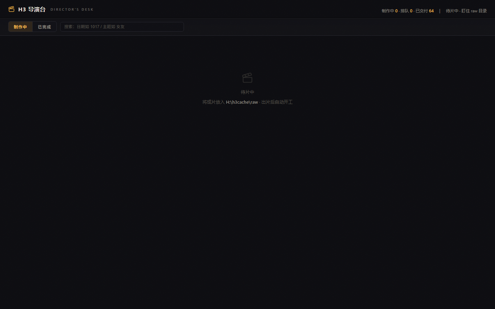
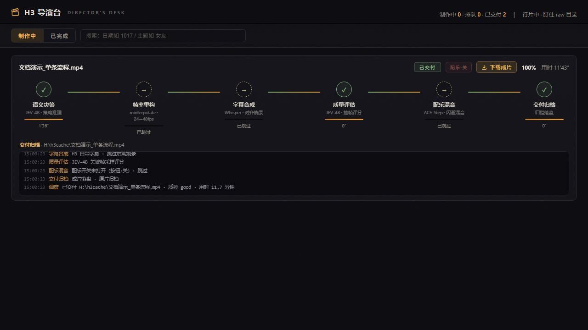
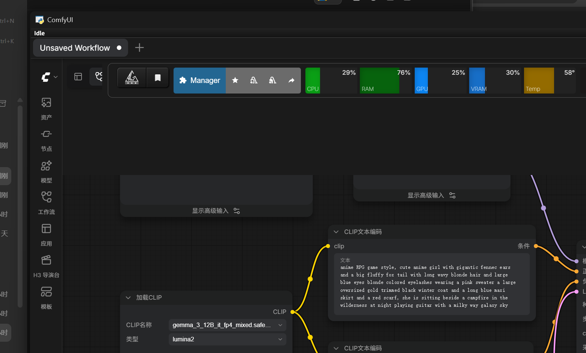

# ComfyUI H3 导演台（comfyui-h3-director）

从零部署一套「H3 导演台」：ComfyUI 只管出片，导演台管发现任务、编排阶段、监控、交付；本插件把两者接起来。

---

## 目录

1. [这个项目是什么 / 不是什么](#1-这个项目是什么--不是什么)
2. [效果截图](#2-效果截图)
3. [硬件与系统前提](#3-硬件与系统前提)
4. [模型与组件清单](#4-模型与组件清单)
5. [导演台服务部署](#5-导演台服务部署)
6. [本插件安装（ComfyUI 集成层）](#6-本插件安装comfyui-集成层)
7. [第一次闭环](#7-第一次闭环)
8. [H3 导演台的设计思路与关键技术](#8-h3-导演台的设计思路与关键技术)
9. [边界与免责](#9-边界与免责)
10. [FAQ 与目录结构](#10-faq-与目录结构)

---

## 1. 这个项目是什么 / 不是什么

一句话：**这个仓库是「集成层 ComfyUI 插件 + 导演台服务的可部署副本」**。你在这里拿到的是把两者拼起来的全部胶水——一个 ComfyUI 侧栏面板与三个节点（插件本体），加上导演台服务 `video_pipeline.py`、长片工作流模板、JEV 决策粘合脚本、守卫/音色工具脚本的逐字节副本与适配指南（`service/` 目录）；按照第 3–7 章从零走一遍，就能在本机跑起「投一个视频文件 / 一份长片订单 → 自动六阶段处理 → 交付成片」的流水线。需要你另行准备的东西只剩三类，且都有公开来源：**模型权重**（第 4 章清单，HuggingFace/ModelScope 下载）、**ComfyUI 本体**（官方安装文档，见 §3）、**JEV 运行时与 Python 环境**（模型发布包自带运行时，见 §5.2 第五步）。本仓库本身不下载、不运行以上任何一项。

| 它是什么 | 它不是什么 |
|---|---|
| ComfyUI 集成层插件：侧栏面板 + 状态/最近交付/提交长片三个节点 | 不是视频生成模型，**不含任何模型权重**（权重见第 4 章清单，合计约 85GB，需自行下载） |
| 导演台服务的可部署副本（`service/video_pipeline.py`，与原件逐字节一致） | 不是导演台服务的运行进程——仓库里没有、也不能替你启动常驻服务，需按第 5 章自己部署启动 |
| 导演台与 ComfyUI 的协作约定文档（raw 目录 + HTTP 接口） | 不接管 ComfyUI 队列、不 hook 采样器、不改 ComfyUI 主程序 |
| 面向 Windows 单机的部署手册（本 README） | 不在读者机器上替任何人跑过生成；本文所有「实测」数据均来自开发机，你的机器需要自己验证 |

> 旧 README 的「零侵入保证」「节点详解」等内容仍有效，已并入第 6、10 章。

---

## 2. 效果截图

所有截图为相对路径，位于本仓库 `docs/screenshots/`，无外链。编号沿用原始截图集：**03 号未收录**（无对应文件，其余 6 张齐全）。

| 截图 | 拍的是什么 | 相关章节 |
|---|---|---|
|  | 导演台控制台首页（`http://127.0.0.1:8898/`）：顶部制作中/排队/已交付统计、「制作中/已完成」标签与搜索框 | [§5](#5-导演台服务部署)、[§7](#7-第一次闭环) |
|  | 已交付视频列表：成片条目（文件名、质检状态、时长）与下载、删除按钮 | [§7](#7-第一次闭环) |
|  | 单条视频任务详情页：视频缩略图与「语义决策→帧率重构→字幕合成→质量评估→配乐混音→交付归档」六阶段进度条 | [§8.2](#82-两条状态机单条六阶段与长片五阶段) |
|  | 一部 16 段长片的分段交付页：分段缩略图网格、「下载整片」等操作按钮 | [§7](#7-第一次闭环)、[§8.6](#86-长片顺序锁与无损拼接) |
|  | 本插件把导演台控制台嵌进 ComfyUI 左侧工具栏的「H3 制片台」侧栏 | [§6](#6-本插件安装comfyui-集成层) |
|  | ComfyUI 节点搜索框输入 `h3` 后出现的三个节点（状态 / 最近交付 / 提交长片） | [§6](#6-本插件安装comfyui-集成层)、[§7](#7-第一次闭环) |

---

## 3. 硬件与系统前提

以下「实测边界」来自开发机：**RTX 5070 Laptop（8GB 显存）+ 32GB 内存，Windows**。

| 项 | 要求 / 实测 |
|---|---|
| 操作系统 | Windows（服务与插件均在本仓库实测于 Windows；路径处理用 `pathlib`，理论跨平台但未在其他系统验证） |
| 显卡 | Nvidia 20 系及以上。**50 系（含 5070）必须装 cu130 及以上版本的 PyTorch**（ComfyUI 官方要求，见 `D:/ComfyUI/README.md:197`） |
| 显存 | 8GB 可跑，实测档位为 **0.3MP 分辨率 / 15 秒时长**（H3 单段默认 5 秒、最长约 15 秒，见 §8.8）。更高分辨率/时长未在本机验证 |
| 内存 | 32GB（H3 主模型 int8 约 19.5GB/个，JEV 4B 约 8.5GB，同时驻留靠内存换显存） |
| Python | 3.10+（插件与导演台服务；开发机服务解释器为 ComfyUI venv 的 Python 3.13.3） |
| 磁盘 | H3 权重合计约 **85GB**（下表逐项），加 JEV 8.5GB + faster-whisper 0.5GB 约 **94GB** 必需；可选 ACE-Step 套件另有 106.9GB。成片/缓存再留几十 GB |
| 网络 | 首次下载模型需外网（ModelScope / hf-mirror / HuggingFace，见 §4 下载渠道） |

> 文本编码器只有 NVFP4 AWQ 一种量化。模型作者的官方说明：*「This nvfp4 text encoder does not require Blackwell GPU to use」*（即不要求 50 系；来源：[Comfy-Org/MiniMax-H3 仓库 README](https://huggingface.co/Comfy-Org/MiniMax-H3)）。本开发机为 50 系，20/30 系实际运行未在本机验证。

> **ComfyUI 本体不随本仓库安装。** 本文不重述安装步骤，直接用官方文档：[Windows 桌面版](https://docs.comfy.org/installation/desktop/windows) / [Portable 绿色版](https://docs.comfy.org/installation/comfyui_portable_windows) / [手动安装（含 PyTorch 版本选择）](https://docs.comfy.org/installation/manual_install)（URL 取自 docs.comfy.org 官方索引）。装好后按 §7.0 前提 5 配 `--output-directory`。

---

## 4. 模型与组件清单

> 本仓库**不包含**下表任何权重文件；请自行下载并放到你的 ComfyUI/H3 目录。H3 系列全部来自同一个 HuggingFace 仓库 [Comfy-Org/MiniMax-H3](https://huggingface.co/Comfy-Org/MiniMax-H3)（hf-mirror.com / ModelScope 有同库镜像）。

| 角色 | 文件名 | 量化 | 体积 | 用途 | 下载渠道 |
|---|---|---|---|---|---|
| H3 主模型（文/图生视频） | `minimax_h3_fl2va_pruned_int8_convrot.safetensors` | int8_convrot | 19.5 GB | H3 文生/图生视频主模型（20970379616 字节） | [HuggingFace](https://huggingface.co/Comfy-Org/MiniMax-H3)（hf-mirror.com / ModelScope 同库镜像） |
| H3 主模型（参考图生视频） | `minimax_h3_ref2va_pruned_int8_convrot.safetensors` | int8_convrot | 19.5 GB | H3 参考图生视频主模型（20970379616 字节） | [HuggingFace](https://huggingface.co/Comfy-Org/MiniMax-H3)（同上镜像） |
| H3 主模型（参考图生视频·fp8 备用） | `minimax_h3_ref2va_pruned_fp8_scaled.safetensors` | fp8_scaled | 19.5 GB | 参考图生视频 fp8 备用链路（20958205608 字节） | [HuggingFace](https://huggingface.co/Comfy-Org/MiniMax-H3)（同上镜像） |
| H3 文本编码器 | `qwen3vl_32b_minimax_h3_nvfp4_awq.safetensors` | NVFP4 AWQ | 14.6 GB | H3 文本编码器（Qwen3-VL-32B，15687142551 字节） | [HuggingFace](https://huggingface.co/Comfy-Org/MiniMax-H3)（同上镜像） |
| H3 视频 VAE（量化） | `minimax_h3_video_vae_int8_convrot.safetensors` | int8_convrot | 2.6 GB | 视频 VAE 量化版（2811065184 字节） | [HuggingFace](https://huggingface.co/Comfy-Org/MiniMax-H3)（同上镜像） |
| H3 视频 VAE（高精度） | `minimax_h3_video_vae_fp16.safetensors` | fp16 | 4.8 GB | 视频 VAE 高精度版（5207808496 字节） | [HuggingFace](https://huggingface.co/Comfy-Org/MiniMax-H3)（同上镜像） |
| H3 音频 VAE | `minimax_h3_audio_vae_fp32.safetensors` | fp32 | 0.6 GB | 音频 VAE（605254808 字节） | [HuggingFace](https://huggingface.co/Comfy-Org/MiniMax-H3)（同上镜像） |
| H3 turbo LoRA（FL2V 8 步） | `minimax_h3_fl2v_turbo_8step_v1.0_comfyui_bf16.safetensors` | bf16 | 1.8 GB | FL2V 加速 LoRA：8 步采样（1956193000 字节） | [HuggingFace](https://huggingface.co/Comfy-Org/MiniMax-H3)（同上镜像） |
| H3 turbo LoRA（Ref2V 4 步） | `minimax_h3_ref2v_turbo_4step_v0.1_comfyui_bf16.safetensors` | bf16 | 1.8 GB | Ref2V 加速 LoRA：4 步采样（1956193000 字节） | [HuggingFace](https://huggingface.co/Comfy-Org/MiniMax-H3)（同上镜像） |
| JEV 决策/质检模型（4B） | `NeoHorse-Jev-4B` | bf16 | 8.5 GB | 语义决策/长片分镜/抽帧质检（du 8941952KB，backbone config dtype=bfloat16） | [HuggingFace TokenRhythm/NeoHorse-Jev-4B](https://huggingface.co/TokenRhythm/NeoHorse-Jev-4B) |
| 字幕对齐模型（faster-whisper small） | `models--Systran--faster-whisper-small` | CTranslate2 fp16 | 0.5 GB | 字幕时间轴对齐（du 474841KB ≈0.45GB，建议指本地路径避免联网） | [HuggingFace Systran/faster-whisper-small](https://huggingface.co/Systran/faster-whisper-small) |
| BGM 生成（ACE-Step v1.5，可选） | `H:/MusicAI/apps/ACE-Step-1.5（MusicAI 套件）` | 未逐文件核对（套件含 YuE2/SeedVC 多引擎） | 106.9 GB | 曲库为空时生成 BGM（不可用自动跳过配乐；MusicAI 套件总计 106.9GB，其中 ACE-Step-1.5 子目录 11.0GB） | 开源仓库 [github.com/ACE-Step/ACE-Step](https://github.com/ACE-Step/ACE-Step)（Apache-2.0，v1.5 已发布）；本开发机用的是 MusicAI 套件封装，与官方仓库封装不同，需自行对齐 |
| 音视频处理工具（ffmpeg） | `imageio_ffmpeg`（ComfyUI venv 内，ffmpeg 7.1） | 程序组件（ffmpeg 7.1） | — | 抽帧/补帧/烧字幕/concat/xfade/混音 | 本地/官方发布页（`pip install imageio-ffmpeg`） |

**为什么 H3 选 int8_convrot 而不是 GGUF？** H3 的隐藏维度是 2688，不能被 256 整除，GGUF 标称 Q4 的版本实际会退化。所以主力用 `int8_convrot`（fl2va / ref2va），其次 `fp8_scaled`（ref2va 备用链路）；本清单不含任何 H3 的 GGUF 文件。模型作者官方口径一致（[仓库 README](https://huggingface.co/Comfy-Org/MiniMax-H3)）：*"For diffusion models prefer `int8_convrot` if you are able to use pytorch with cu130."*、*"`fp8_scaled` should only be used if you cannot use `int8_convrot`."*

**注意不对称**：ref2va 有 fp8 备用链路，**fl2va 只有 int8_convrot 一种**、无备用——若 int8 链路在你的机器出问题，文生/图生视频主模型没有备选量化（换量化只能等官方发布，来源见 HF 仓库）。

**下载渠道建议：** 国内网络 ModelScope 最快；HuggingFace 直连不稳时走 `https://hf-mirror.com` 同库镜像（导演台服务代码里 `HF_ENDPOINT` 默认也已设为 hf-mirror.com，见 `service/video_pipeline.py:32` 一带的 setdefault）。

**权重放到哪（放置位置不明会直接导致工作流找不到模型）：** 开发机的实际布局是 ComfyUI 标准模型子目录，逐文件核对过：

| 放置目录 | 放入的文件 |
|---|---|
| `<模型根>/diffusion_models/` | fl2va 主模型、ref2va 主模型 ×2（三个 19.5GB 的 safetensors） |
| `<模型根>/text_encoders/` | `qwen3vl_32b_minimax_h3_nvfp4_awq.safetensors` |
| `<模型根>/vae/` | 视频 VAE ×2、音频 VAE |
| `<模型根>/loras/` | 两个 turbo LoRA |

`<模型根>` 可以是 ComfyUI 自带的 `ComfyUI/models/`，也可以用 `extra_model_paths.yaml` 把独立目录映射进来——开发机做法（`D:\ComfyUI\extra_model_paths.yaml`，已实测生效）：

```yaml
comfyui:
  base_path: H:/MiniMax-H3      # 换成你的模型根
  is_default: true
  diffusion_models: diffusion_models
  text_encoders: text_encoders
  vae: vae
  loras: loras
```

工作流里引用的都是裸文件名（如 `minimax_h3_fl2va_pruned_int8_convrot.safetensors`），ComfyUI 按上述目录解析，因此**文件必须落在对应子目录**。

> 两个 turbo LoRA 的字节数完全相同（均为 1,956,193,000）**不是表格复制错误**——已对开发机 `H:/MiniMax-H3/loras/` 下两个实际文件逐一核过 `ls -la`，确实同字节数。

---

## 5. 导演台服务部署

导演台本体是 `service/video_pipeline.py`（与开发机原件逐字节一致，md5 `6accc9becf52c6b74a73e607113a7194`；`service/ADAPT.md:3`）。原机启动链是 `pipeline.bat` → `restart_pipeline.ps1` → 用 `D:\ComfyUI\venv\Scripts\pythonw.exe` 运行 `video_pipeline.py`；本仓库给你可直接改的副本 `service/restart_pipeline.example.ps1`。本节内联关键步骤，**逐条路径的完整对照表以 [`service/ADAPT.md`](service/ADAPT.md) 为准**。

### 5.1 依赖安装

服务本体只用标准库，但音色/字幕/守卫功能需要以下三方包（装进**运行服务的那个 Python 环境**；实测版本 numpy 2.5.2 / Pillow 12.3.0 / faster-whisper 1.2.1，见 `service/ADAPT.md:14-18`）：

```bash
pip install numpy pillow faster-whisper imageio-ffmpeg
```

`imageio-ffmpeg` 本身非必须——它只是 ffmpeg 可执行文件的一个来源（见下）。

### 5.2 部署副本与路径适配

> 下文命令里的 `<本仓库路径>` 指你克隆/存放本仓库的位置（本开发机是 `H:\h3cache\comfyui-h3-director`），每条命令使用前先替换。

**第一步：把服务放到你的程序目录。** 例如（路径可自定，下文以 `C:\H3DirectorDesk` 为例）：

```powershell
mkdir C:\H3DirectorDesk
copy "<本仓库路径>\service\video_pipeline.py" "C:\H3DirectorDesk\video_pipeline.py"
```

**第二步：改路径常量。** 所有硬编码路径集中在 `video_pipeline.py` 开头常量区（34–77 行；字体表 127–134 行、whisper 模型 2108 行、审核目录 3186 行起），一次性替换。最少要核对这几组（完整 34 条对照表见 `service/ADAPT.md` 第 2 节）：

| 常量（副本行号） | 原值 | 含义 / 改法 |
|---|---|---|
| `RAW`（:34） | `H:\h3cache\raw` | 待处理视频输入队列目录，必须与 ComfyUI SaveVideo 输出目录一致（见 §8.5 硬前提） |
| `OUT`（:35） | `H:\h3cache` | 交付归档根：原始/失败/work/films 都挂在下面 |
| `DL`（:39） | `D:\H3DirectorDesk` | 程序/配置目录（dialogue.json、模板、tools 都在这里）→ 改成你的 `C:\H3DirectorDesk` |
| `CACHE` / `DOWNLOADS`（:40-41） | `H:\h3cache\h3_cache` / `downloads` | 运行状态/日志/历史 与 浏览器下载落点 |
| `FFMPEG`（:48） | `D:\ComfyUI\venv\...\ffmpeg-win-x86_64-v7.1.exe` | ffmpeg 可执行文件，三选一：① `pip install imageio-ffmpeg` 后指向包内 `binaries\` 里的 exe（**文件名带版本号、随包版本变化，以实际文件名为准**）；② 装好 ffmpeg 进 PATH 后改成 `"ffmpeg"`；③ 守卫工具走环境变量 `H3_GUARD_FFMPEG` |
| `COMFY`（:56） | `http://127.0.0.1:8188` | 你的 ComfyUI 地址 |
| `JUDGE_SCRIPT` / `JEV_PY` / `DECIDE_SCRIPT`（:49-51） | `H:\JEV\...` | JEV 决策脚本与独立 venv，按你的 JEV 部署改 |
| `COMFY_INPUT`（:71） | `D:\ComfyUI\input` | ComfyUI LoadImage 输入图目录（首帧直落此处） |

**第三步：程序目录伴随文件**（与 `video_pipeline.py` 同放，缺了对应功能降级或报错）：

- `dialogue.json` —— 全局台词/风格配置，**必须**。从模板复制：`copy "<本仓库路径>\service\config.example.json" "C:\H3DirectorDesk\dialogue.json"`，按需改 `style`/`lines` 等键（全部键说明就在该模板内）。
  > ⚠️ 本仓库有**两份同名的 `config.example.json`**、角色不同别拿错：`service/config.example.json` 是**导演台 dialogue.json 模板**（复制到程序目录改名 dialogue.json）；仓库根目录的 `config.example.json` 是**ComfyUI 插件配置模板**（复制到插件目录改名 config.json，见 §6）。
- `h3_film_seg_template.json` —— 长片模式的 ComfyUI API 工作流模板，**长片闭环必需，本仓库已提供**：`copy "<本仓库路径>\service\h3_film_seg_template.json" "C:\H3DirectorDesk\h3_film_seg_template.json"`（与开发机原件 md5 一致）。模板内只有裸模型文件名、无机器路径，不用改；导演台每段会自动改写其中 5 个节点（LoadImage 首帧/提示词/种子/时长/SaveVideo 前缀，`video_pipeline.py:700-705`）。
- `tools\` 子目录 —— **本仓库已提供**：`copy /E /I "<本仓库路径>\service\tools" "C:\H3DirectorDesk\tools"`。内含 `h3_guard.py`（提示词守卫，43KB）、`h3_voice.py`（音色转换，**还需外部 Seed-VC venv/CLI**，见 `service/ADAPT.md`）、`h3_prompt_skill.py`（`H3_PROMPT_SKILL=1` 时启用的提示词封装）与两份示例档案（`h3_guard_profiles\same_rain.guard.json`、`h3_voice_profiles\same_rain.voice.json`）。不用守卫/音色功能可整目录不带（代码按「跳过」处理）。

**落地目录不用手建**：服务启动时自动创建全部落地目录（`RAW`/`原始`/`work`/`失败`/`films`/`downloads`/`h3_cache`，`video_pipeline.py:3215-3216` 的 `os.makedirs(..., exist_ok=True)` 循环；bgm 等使用点另有按需创建）。你只需要保证这些常量指向的**磁盘/根目录存在且可写**。

**第四步：字体与 whisper 模型。** 字体有两处：字体表（127–134 行）默认指向 `C:\Windows\Fonts` 下的雅黑/黑体/楷体/宋体/仿宋/隶书，缺字体时代码回退雅黑（:2009-2010）；另有一处 **H3 风格字幕**路径（:2037）硬编码 `C:\Windows\Fonts\Noto Sans SC.ttf`——用于复刻 H3 自带字幕样式烧录，该字体缺失时 libass 会回退默认字体，**字幕效果不保证**，需要此效果就安装 Noto Sans SC 或改 :2037 路径。faster-whisper 模型（2108 行 `wm`）两种给法：

```bash
# 给法一（推荐，离线加载）：用 huggingface-cli 下载出标准 hub 缓存布局，再把 wm 指到 snapshots\<commit> 目录
pip install -U huggingface_hub
set HF_HOME=<你的缓存根>          # 开发机是 E:\local-models\huggingface
set HF_ENDPOINT=https://hf-mirror.com
huggingface-cli download Systran/faster-whisper-small
# 产出 <HF_HOME>\hub\models--Systran--faster-whisper-small\snapshots\<commit>\{model.bin,config.json,tokenizer.json,vocabulary.txt}
```

> 该布局已在开发机实测核对（snapshots 目录含上述 4 个文件）。给法二：把 `wm` 改成 `"small"` 让 faster-whisper 自动下载（同样受 `HF_ENDPOINT` 镜像影响，见 `service/ADAPT.md` 第 3 节）。

**第五步：JEV 决策环境（六阶段第一阶与长片分镜的硬依赖）。** 三个粘合脚本**本仓库已提供**（`service/jev/`：`h3_judge.py` 质检 / `video_decide.py` 单片决策 / `storyboard_decide.py` 分镜，与开发机原件 md5 一致）；其余组件全部公开可获取——**运行时随模型发布**：[NeoHorse-Jev-4B](https://huggingface.co/TokenRhythm/NeoHorse-Jev-4B) 的 HF release 自带 `neohorse_decision` 运行时（`dist/*.whl` 或 `./package` 源码，见模型页 *Deployment and API Guide*）。部署三步：

```bash
# 1) 下载完整模型发布包（backbone/ + tokenizer/ + pointer_head.safetensors + model_manifest.json + 运行时），解压到如 H:\JEV\NeoHorse-Jev-4B
# 2) 建独立 venv 装运行时与 ML 依赖（模型页记录环境：Python 3.12 / torch 2.8 / transformers 5.17 / triton 3.7.1 / flash-linear-attention 0.5.2；
#    开发机 venv 实测版本：torch 2.11.0+cu128 / transformers 5.19.0 / accelerate 1.15.0 / bitsandbytes 0.50.2）
python -m venv H:\JEV\venv
H:\JEV\venv\Scripts\pip install <模型包内 dist/neohorse_decision-1.0.0-py3-none-any.whl> --no-deps
H:\JEV\venv\Scripts\pip install torch transformers accelerate bitsandbytes   # 版本对齐上面记录环境
# 3) 复制脚本并改常量：copy "<本仓库路径>\service\jev\*.py" "H:\JEV\"
#    三个脚本内 MODEL_DIR = r"H:\JEV\NeoHorse-Jev-4B"（video_decide.py:12 / storyboard_decide.py:15 / h3_judge.py:25）按你的路径改；
#    再把 video_pipeline.py 的 JUDGE_SCRIPT/JEV_PY/DECIDE_SCRIPT/STORYBOARD_SCRIPT（:49-51、:63）指向它们
```

> JEV 默认 device=cpu（8G 显存塞不下 9GB 权重，裁判在生成间隙跑；`h3_judge.py` 文件头自述），且生成中拒绝加载防内存打爆——所以它不与 H3 抢显存。

**第六步：确认其余外部服务。** ComfyUI（:8188，**需先装好 H3 工作流，来源与做法见 §7.0 前提 4/5**）、音乐引擎 ACE-Step（`http://127.0.0.1:8001/health`，服务会按需自动拉起 `start_engine_gpu.bat`，不可用则自动跳过配乐；官方开源仓库见 §4 表）。

### 5.3 启动

```powershell
# 方式一：直接启动（<你的Python> 换成装了 5.1 依赖的解释器，如 D:\ComfyUI\venv\Scripts\pythonw.exe）
& "D:\ComfyUI\venv\Scripts\pythonw.exe" "C:\H3DirectorDesk\video_pipeline.py"

# 方式二：用重启脚本副本（先改脚本里两处：第 8 行解释器 `D:\ComfyUI\venv\Scripts\pythonw.exe`、
#   第 9 行脚本路径 `D:\H3DirectorDesk\video_pipeline.py`，都换成你机器的值；
#   第 2-4 行按命令行匹配旧进程的 `*video_pipeline.py*` 模式只要文件名不改就无需动）
powershell -NoProfile -ExecutionPolicy Bypass -File "<本仓库路径>\service\restart_pipeline.example.ps1"
```

端口 8898 被占时新实例自动退出（单实例保护，`video_pipeline.py:3211-3213`），不会出现双实例。开机自启可以把方式二加进任务计划程序。

### 5.4 健康检查

```bash
curl http://127.0.0.1:8898/status
```

返回 200 与 JSON（含任务/队列/事件流）即在线；控制台页面在 `http://127.0.0.1:8898/`（即截图 [01](docs/screenshots/01_导演台首页.png)）。

**启动失败怎么排查（pythonw 无窗口、配置错了会静默退出，别只盯着健康检查）：**

```powershell
# 先用有窗口的 python.exe 前台跑一次，报错直接打印在终端：
& "D:\ComfyUI\venv\Scripts\python.exe" "C:\H3DirectorDesk\video_pipeline.py"
```

- 常见首错：`dialogue.json` 不在程序目录（`load_dialogue` 直接打开，处理任务时才触发）；路径常量指向不存在的盘符。
- 后台运行日志在 `<CACHE>\pipeline.log`（默认 `H:\h3cache\h3_cache\pipeline.log`，常量 `LOGF`，`video_pipeline.py:44` 一带）。
- 端口 8898 被占会打印「导演台已在运行（端口被占），本实例退出」后退出（:3211-3213）——那是单实例保护，不是故障。

---

## 6. 本插件安装（ComfyUI 集成层）

要求：ComfyUI 0.3+（新旧前端均可）、Python 3.10+、导演台服务已在 `127.0.0.1:8898` 在线（§5.4 通过）。插件只用标准库（`urllib`/`json`/`pathlib`）。

### 三种安装方式

```bash
# 方式 A：ComfyUI-Manager（推荐）
#   ComfyUI 界面 → Manager → Install via Git URL → 填 <本仓库 git 地址> → 重启 ComfyUI

# 方式 B：手动克隆
cd <你的ComfyUI>/custom_nodes
git clone <本仓库 git 地址> comfyui-h3-director
# 重启 ComfyUI

# 方式 C：开发模式（软链接，Windows 管理员 cmd；两个路径都换成你的：ComfyUI 目录 与 本仓库所在位置）
mklink /D "<你的ComfyUI>\custom_nodes\comfyui-h3-director" "<本仓库路径>"
```

> `<本仓库 git 地址>`、`<你的ComfyUI>` 为占位符，按你的实际情况替换。**本仓库当前尚未发布**（无公开远端地址，也未上架 ComfyUI Registry）；维护者的发布流程见仓库内 [PUBLISHING.md](PUBLISHING.md)。如果你拿到的是文件夹而非 git 克隆，直接用方式 C 软链。

重启后：节点面板 **H3/Director** 分类下出现三个节点（见截图 [07](docs/screenshots/07_ComfyUI导演台入口.png)），左侧栏出现「H3 制片台」（内嵌 8898 控制台，见截图 [06](docs/screenshots/06_嵌入ComfyUI侧栏.png)）。零侵入保证：只用 `NODE_CLASS_MAPPINGS`、`WEB_DIRECTORY`、`PromptServer.routes` 三个公开扩展点；不 hook 队列、不调 `/prompt`；所有 HTTP 带超时；卸载删文件夹即可。

### config.json 配置

复制 `config.example.json` 为插件目录内 `config.json`（已被 `.gitignore` 忽略）：

```json
{
  "director_url": "http://127.0.0.1:8898",
  "raw_dir": "H:/h3cache/raw",
  "timeout": 8
}
```

| 字段 | 说明 | 环境变量覆盖 |
|---|---|---|
| `director_url` | 导演台地址，末尾不带 `/` | `H3_DIRECTOR_URL` |
| `raw_dir` | **必须指向导演台监听的 raw 目录**（§5.2 的 `RAW` 常量），`提交长片` 节点把 `<片名>.film.json` 写到这里 | `H3_DIRECTOR_RAW_DIR` |
| `timeout` | HTTP 超时秒数（1–60） | `H3_DIRECTOR_TIMEOUT` |

优先级：节点输入 > 环境变量 > `config.json` > 默认值（`config.py:44-46`）。

三个节点速览：**状态**（`H3DirectorStatus`，读 `/status` 输出摘要+JSON，只读）；**最近交付**（`H3DirectorLastResult`，输出 file/verdict/font/bgm/mood/download_url）；**提交长片**（`H3DirectorSubmitFilm`，输入 film_name/style/lines/lang/reuse，原子写 `<片名>.film.json` 到 `raw_dir`，不等待生成完成）。

---

## 7. 第一次闭环

### 7.0 前提清单（缺一项闭环就会卡，逐项打勾）

| # | 前提 | 怎么达成 |
|---|---|---|
| 1 | 导演台服务在线 | §5.4 健康检查返回 200 |
| 2 | 插件已装、`raw_dir` 配对 | §6；`raw_dir` = 导演台 `RAW` 常量指向的目录 |
| 3 | ComfyUI 8188 在线 + H3 权重就位 | ComfyUI 本体用[官方安装文档](https://docs.comfy.org/installation/manual_install)装（50 系记得 cu130+，§3）；权重按 §4「放置位置」落入四个子目录 |
| 4 | ComfyUI 里装了 H3 工作流 | 官方模板：[video_minimax_h3_t2v.json](https://github.com/Comfy-Org/workflow_templates/blob/main/templates/video_minimax_h3_t2v.json)（文生视频）/ [i2v](https://github.com/Comfy-Org/workflow_templates/blob/main/templates/video_minimax_h3_i2v.json) / [r2v](https://github.com/Comfy-Org/workflow_templates/blob/main/templates/video_minimax_h3_r2v.json) 等，教程见 [docs.comfy.org/tutorials/video/minimax/minimax-h3](https://docs.comfy.org/tutorials/video/minimax/minimax-h3)（均出自 [Comfy-Org/MiniMax-H3 仓库 README](https://huggingface.co/Comfy-Org/MiniMax-H3)，本仓库不复述工作流内容） |
| 5 | ComfyUI 输出目录 = raw 目录 | 启动参数 `--output-directory <你的RAW目录>`。开发机实证（`D:\ComfyUI\launcher.bat`）：`python.exe main.py --lowvram --cache-none --disable-pinned-memory --output-directory H:/h3cache/raw` |
| 6 | 长片模板已复制到程序目录 | §5.2 第三步（`service/h3_film_seg_template.json`，仓库已提供）；模板内 SaveVideo 前缀 `filmseg_` 已内置，无需手配 |
| 7 | JEV 已部署且路径常量已改 | **硬前提**：六阶段第一阶与长片分镜都靠它，缺失时任务直接失败。可达成：脚本 `service/jev/`（仓库自带）+ 运行时与权重从 [NeoHorse-Jev-4B](https://huggingface.co/TokenRhythm/NeoHorse-Jev-4B) 发布包获取，部署三步见 §5.2 第五步 |

### 7.1 路线 A：单条视频闭环（最短路径）

自己在 ComfyUI 里跑官方 H3 工作流（前提 4 的 t2v/i2v 模板），SaveVideo 自然落在 raw 目录（前提 5）；导演台发现这个 mp4 后自动走六阶段后处理（语义决策→帧率重构→字幕→质检→配乐→交付）。你不需要投任何订单文件。

### 7.2 路线 B：长片闭环（一个订单跑完整片）

**第 1 步：投订单。** 复制示例订单、改成你的片名（片名不能用路径分隔符）：

```powershell
copy "<本仓库路径>\examples\film.example.json" "<你的RAW目录>\我的第一部长片.film.json"
```

> ⚠️ `<你的RAW目录>` **必须**是导演台 `RAW` 常量（`video_pipeline.py:34`）指向的目录。投错目录不会有任何报错——detector 只扫自己的 raw 目录，订单会永远躺在你投错的目录里没人接手。

然后编辑该文件，把 `lines` 换成你的台词（一行一句）、`style` 换成你的风格锚：

```json
{
  "style": "3D 卡通都市恋爱，克制、温柔、真实沟通",
  "lang": "zh",
  "lines": ["第一句台词", "第二句台词", "第三句台词", "第四句台词"],
  "reuse": []
}
```

也可以不手写文件：在 ComfyUI 工作流里用「H3 导演台 · 提交长片」节点（截图 [07](docs/screenshots/07_ComfyUI导演台入口.png)）填同样内容，节点会替你原子写入 `raw_dir`。

**第 2 步：看它跑。** 打开 `http://127.0.0.1:8898/`，或 ComfyUI 侧栏「H3 制片台」（截图 [06](docs/screenshots/06_嵌入ComfyUI侧栏.png)）。detector 每 4 秒扫一次 raw 目录，文件大小连续两轮稳定后才接手（§8.5），所以投单后几秒内出现任务卡片。示例 4 句台词按「每段 ≤3 行」切成 2 段（段数 = ⌈行数/3⌉）；每段由导演台改模板 5 个节点后 POST 给 ComfyUI 生成（§5.2 第三步），逐段看得到 分镜→生成→质检→字幕 的推进（截图 [05](docs/screenshots/05_长片16段交付.png) 是一部 16 段长片的同类页面）。

**第 3 步：收片。**

- 长片成片落在 `H:\h3cache\films\<片名>\<片名>.mp4`（按你改的 `OUT`/`FILMS` 常量为准；同目录还有 `seg_XX.mp4` 分段与 `manifest.json`，`service/video_pipeline.py:62`）；单条视频成片落在 `H:\h3cache\<视频名>.mp4`。
- 页面上点「下载整片 / 下载成片」按钮即走 `/download` 接口；接口形式为 `GET http://127.0.0.1:8898/download?name=<片名>/<片名>.mp4`（长片）或 `?name=<视频名>.mp4`（单条；中文文件名需 URL 编码，浏览器按钮会自动处理）。每次经 `/download` 下载的文件会同步镜像一份到 `H:\h3cache\downloads`。
- 已交付列表见截图 [02](docs/screenshots/02_已完成长片与分段.png)。

---

## 8. H3 导演台的设计思路与关键技术

本章把导演台（`video_pipeline.py`，约 3200 行）的设计事实按主题归类；引用行号均指 `service/video_pipeline.py` 副本。标注「说明.md」「使用说明.md」「H3-text2video.json」「D:/ComfyUI/README.md」的是**开发机设计文档/工作流的出处标注，不随本仓库分发、读者侧不可核查**，仅用于交代结论来源。

### 8.1 总体架构：生成与编排分离

ComfyUI 只负责出片、导演台只负责发现任务/编排阶段/监控/交付，两者通过 raw 目录与 HTTP 接口协作，可各自独立升级重启（说明.md:17-18）。导演台对 ComfyUI 是**纯 HTTP 客户端**：`GET /queue` 探忙防止显存叠加；长片改模板节点后 `POST /prompt`、轮询 `/history` 取片（SaveVideo 落 raw，`filmseg_` 前缀防重入，:66、:3143）；首帧/种子帧复制进 ComfyUI input 目录供 LoadImage。

```text
   投 mp4 / <片名>.film.json
            │
            ▼
┌─ H:\h3cache\raw ── detector（每 4s 扫描；大小连续两轮稳定且 >1MB 才入队 :721）─┐
│                                                                              │
│              FIFO 队列 ──► worker（单线程串行执行，一次一条）                  │
│                                                                              │
│   H:\h3cache\: 原始\ work\ 失败\ films\ bgm\ downloads\ h3_cache\(状态/日志/历史)│
└──────────────────────────────────┬───────────────────────────────────────────┘
                                   ▼
        ┌──────── H3 导演台 video_pipeline.py（127.0.0.1:8898 :3210）────────┐
        │ main()(:3208) 单例 HTTP 台：GET /status、/download、/              │
        │     POST /task/bgm、/task/voice、/task/delete                     │
        │ 后台线程：detector · worker · 审核入库 watcher(:3186)              │
        │ 程序与模板在程序目录（dialogue.json、h3_film_seg_template.json、tools\）│
        └──────┬──────────────────┬─────────────────────┬────────────────────┘
               │ HTTP 客户端       │ 首帧/种子帧复制       │ 子进程
               ▼                  ▼                     ▼
        ComfyUI :8188      ComfyUI\input          JEV 独立 venv（决策/分镜/质检）
        /queue /prompt     （供 LoadImage）       ACE-Step :8001（按需拉起，BGM）
        /history                                  faster-whisper（字幕对齐）
               ▲
               │ iframe(?embed=1) + GET /status（只读）     写 <片名>.film.json
        ┌──────┴──────────────────────────────────────────────────┐
        │ 本插件 comfyui-h3-director（侧栏面板 + 3 个节点）          │
        └─────────────────────────────────────────────────────────┘
```

### 8.2 两条状态机：单条六阶段与长片五阶段

导演台是**状态机而非线性脚本**：阶段可跳过、可失败、重启后从 history/订单恢复（说明.md:20-21）。

- **单条六阶段**（截图 [04](docs/screenshots/04_单条六阶段.png)）：语义决策 → 帧率重构（可选）→ 字幕合成 → 质量评估 → 配乐混音 → 交付归档；每阶段写 start/detail/end 并进全局事件流（说明.md:69-70）。
- **长片五阶段**：分镜 → 逐段（复用/生成→归一化→质检→字幕）→ 拼接 → 整片配乐 → 交付；质检不过换 seed 原位重跑 ≤2 次（说明.md:76-86）。
- **film.json 契约**：raw 下落盘 `<片名>.film.json`（`style`/`lang`/`lines`/`reuse`）触发长片；段数只由台词行数决定（每段 ≤3 行，段数=⌈行数/3⌉），`reuse` 数量不驱动段数（说明.md:80-81）。

### 8.3 单工作线程串行执行

H3/JEV/ACE-Step 都吃内存显存，8G 显存机器并发等于自杀；导演台用 FIFO 队列 + 单 worker 一条一条来（说明.md:23-24）。这也是 §3 实测边界成立的前提。

### 8.4 JEV 的边界：只决策、不生成

本地 4B 的 JEV 只负责语义决策、长片分镜、抽帧质检和筛废片，**不会让 H3 画得更好**（说明.md:26-27）。长片中 JEV 只回答：是否分镜、每条边界 cut/crossfade、风格锚、字体、整片 BGM need/none+情绪；边界多的问题拆成「全局问题+转场分批」避免超出单次问题上限（说明.md:82）。

### 8.5 任务发现与两个部署硬前提

detector 每 4 秒扫描 raw 目录（:721、:3205）。**「大小连续两次稳定且 >1MB」的入队规则只作用于 `.mp4`**（:3142-3152，防半写文件）；长片订单 `.film.json` 走独立分支（:3160-3162），**只要落盘且 JSON 解析通过即入列，无大小门槛**。因此有两个硬前提（说明.md:125-126）：

1. ComfyUI 的 **SaveVideo 输出目录必须是 `H:\h3cache\raw`**（或你在 :34 改的 `RAW` 值），否则导演台发现不了任务。实现方式是 ComfyUI 启动参数 `--output-directory`（开发机实证见 §7.0 前提 5）；
2. 长片分段前缀必须是 **`filmseg_`**（:66），detector 据此跳过段产物、不会把分段当新任务重复处理（:3143）。实现方式：长片模板 SaveVideo 节点（92）内置该前缀，且导演台每段运行时还会改写 `filename_prefix = filmseg_<片名>_s<段号>`（:705），无需手工配置。

### 8.6 长片顺序锁与无损拼接

- **顺序锁**：分段可以重跑但只在原 idx 原位替换（`os.replace`）；拼接只按 idx 顺序读分段、写新文件，单个视频永远不被拼接改动（说明.md:29-30、83-84）。
- **拼接策略**：全 cut 且参数一致走 `concat -c copy` 无损拼接；含 crossfade 走 xfade 链；参数不一致先归一化副本——全程只读分段、写新文件（说明.md:84）。

### 8.7 字幕为什么必须后处理

扩散模型直接画字必乱码。长片先检测 H3 自带字幕、有则跳过烧录；否则用 faster-whisper 对齐时间轴再以 ASS 烧录（说明.md:83；「画字必乱码」为任务给定事实）。

### 8.8 H3 生成侧的三个工程细节

- **音画联合生成**：语音、音效、音乐与画面在同一次前向中联合建模输出原生立体声，口型与语音同源（工作流 H3-text2video.json 模型描述；使用说明.md:92）。
- **turbo LoRA**：`minimax_h3_fl2v_turbo_8step_v1.0`（8 步）与 `minimax_h3_ref2v_turbo_4step_v0.1`（4 步）两个 bf16 LoRA 分别把采样步数降下来（文件名见第 4 章清单）。
- **帧数对齐**：时长按 17k+5 网格对齐（Math Expression `max(5, round(a*24)) + (5 - (max(5, round(a*24)) % 17)) % 17`），24fps，默认 5 秒、最长约 15 秒（H3-text2video.json 表达式；使用说明.md:111）。

### 8.9 量化选择

H3 隐藏维度 2688 不能被 256 整除，GGUF 版 H3 会退化；优先 `int8_convrot`（fl2va/ref2va 主力），其次 `fp8_scaled`（ref2va 备用链路）（说明.md:136、使用说明.md:30、实际文件构成）。与 §4 清单一致。

### 8.10 可观察、可恢复、可追溯

- `/status` 快照、事件流、sticky 日志、自适应 ETA、`pipeline_history.json` 与长片 `manifest.json` 支撑无人值守（说明.md:32-33）。
- **监控是增量渲染不是 token 流**：前端每 1.5 秒 fetch `/status`、事件按 seq 增量追加（每线路最多 80 行）、阶段进度每 400ms 时钟插值；粘性日志上滚固定并出现「N 条新输出·回到最新」药丸（说明.md:92-95）。

### 8.11 显卡与 PyTorch 版本要求

ComfyUI 官方要求 Nvidia 20 系及以上（含 50 系）必须使用 **cu130 及以上**版本的 PyTorch（`D:/ComfyUI/README.md:197`）——这就是 §3 里 50 系装 cu130 的出处。

---

## 9. 边界与免责

诚实说清，避免误解：

- **本仓库不含模型权重，也不含任何服务进程。** 它是集成层插件 + 导演台服务的可部署副本；权重按第 4 章自行下载，服务按第 5 章自行部署启动。
- **本仓库不生成视频，也没有在读者机器上替任何人跑过生成。** 本文全部实测数据（0.3MP/15s 档、依赖版本、md5）来自开发机；你的机器上的结果需要你自己验证。
- 组件必需性：**ComfyUI + H3 权重 + ffmpeg 必需**（没有它们没有画面/没有音视频处理）；**faster-whisper 条件必需**（H3 自带字幕被检测到时跳过，否则烧字幕需要它）；**ACE-Step 可选**（曲库为空时才用来生成 BGM，不可用自动跳过配乐，无直链、见 §4）。
- **JEV：必需，部署来源已闭环。** JEV = 独立 venv + [NeoHorse-Jev-4B](https://huggingface.co/TokenRhythm/NeoHorse-Jev-4B) 权重（HF 发布包**自带 `neohorse_decision` 运行时**）+ 三个粘合脚本（`h3_judge.py`/`video_decide.py`/`storyboard_decide.py`，**本仓库 `service/jev/` 已提供**，与原件 md5 一致）。部署三步与依赖版本见 §5.2 第五步；脚本内 `MODEL_DIR` 常量按你的路径改。缺失或路径不对时，单片在六阶段第一阶抛 `RuntimeError("JEV 决策未产出…")`（`video_pipeline.py:2348`）、长片在分镜阶段同样失败（:2629），任务进失败目录，**没有降级路径**——这是硬依赖，不是可选项。
- **字幕字体回退链**：首选字体缺失时回退 `C:\Windows\Fonts\msyhbd.ttc` 雅黑粗体（:2009-2010）；若雅黑也缺失（如非中文 Windows 且未装中文字体），字幕加载会抛异常、该阶段失败——这种情况需自备中文字体并改 `FONTS` 表（127–134 行）。
- 8G 显存的上限与代价：只能跑 0.3MP/15s 档；为防显存叠加，导演台强制单线程串行（§8.3），所以吞吐低是设计选择不是缺陷。更高档位未在本机验证。
- 许可：本仓库代码 **MIT**（见 [LICENSE](LICENSE)）。第 4 章模型各自有其许可证：若你的工作流引用 Ideogram 等第三方模型，注意其**非商业许可**限制，商用前自行核对各模型条款。

---

## 10. FAQ 与目录结构

### FAQ

**Q1：投了 mp4 / film.json，导演台没反应？**
先分清两条入队规则（§8.5）：**mp4** 要等大小连续两轮稳定且 >1MB（半写保护，约 4–8 秒）；**film.json 订单**没有大小门槛，落盘且 JSON 解析通过即入列——解析失败或 `lines` 不是数组会**静默跳过等下一轮**（`video_pipeline.py:3168-3174` 的 continue，无报错），先自己校验 JSON。两者都要求文件落在导演台监听的 raw 目录（默认 `H:\h3cache\raw`，服务在线见 §5.4）。

**Q2：长片分段被当成新任务重复处理了？**
检查 ComfyUI SaveVideo 的文件名前缀必须是 `filmseg_`，且输出目录必须是 raw 目录（§8.5 两个硬前提）。

**Q3：侧栏没有「H3 制片台」？**
看浏览器控制台是否有 `[H3Director]` 日志；确认没有同 id 标签；硬刷新（Ctrl+F5）。旧定制版抽屉（`ComfyUI-PipelineMonitor`，tab id `h3DirectorDesk`）与本插件（`h3DirectorPanel`）互不冲突，可共存。

**Q4：状态节点报「连不上导演台」？**
插件不会启动服务。先确认 `http://127.0.0.1:8898/status` 能打开；远程部署把 `director_url` 改成实际地址。

**Q5：8G 显存 OOM / 想更快？**
留在 0.3MP/15s 档；确认 PyTorch 是 cu130+（50 系）；不要并发投任务——导演台本来就会串行执行（§8.3），同时跑 ComfyUI 别的重任务会叠加显存（导演台投片前会 `GET /queue` 探忙）。

**Q6：模型下载太慢 / 下不动？**
国内走 ModelScope 最快；HF 直连不稳走 `https://hf-mirror.com`（§4 下载渠道建议）。

**Q7：怎么在 ComfyUI 工作流里直接提交长片？**
用「H3 导演台 · 提交长片」节点，`film_name` 不能带路径分隔符；节点只负责原子写 `<片名>.film.json`，不等待生成完成（§6、§7）。

**Q8：怎么停/重启导演台？**
停止（按命令行精确匹配，不误杀其他 python；与 `restart_pipeline.example.ps1` 同款做法）：

```powershell
Get-CimInstance Win32_Process -Filter "Name='pythonw.exe' or Name='python.exe'" |
  Where-Object { $_.CommandLine -like '*video_pipeline.py*' } |
  ForEach-Object { Stop-Process -Id $_.ProcessId -Force }
```

重启再用 §5.3 任一方式；重启后任务从 history/订单恢复（§8.2）。

**Q9：仓库里两份 `config.example.json` 是同一个东西吗？**
不是，极易拿错：`service/config.example.json` → 复制到**程序目录**改名 `dialogue.json`（导演台台词/风格，§5.2）；根目录 `config.example.json` → 复制到**插件目录**改名 `config.json`（插件连导演台的地址，§6）。

**Q10：长片模板 `h3_film_seg_template.json` 从哪来？要改吗？**
本仓库自带：`service/h3_film_seg_template.json`（与开发机原件 md5 一致），复制到程序目录即可；模板内是裸模型文件名、无机器路径，不用改。导演台每段会改写其中 5 个节点（§5.2 第三步）。

**Q11：JEV 从哪下载？**
三件套都有来源：粘合脚本在 `service/jev/`（本仓库自带）；模型与**运行时**都在 [HuggingFace TokenRhythm/NeoHorse-Jev-4B](https://huggingface.co/TokenRhythm/NeoHorse-Jev-4B) 发布包（含 `neohorse_decision` wheel/源码、backbone 权重）；venv 依赖清单见 §5.2 第五步。装好后别忘了改脚本 `MODEL_DIR` 与 `video_pipeline.py:49-51、:63` 四个路径常量。

**Q12：为什么截图没有 03？**
编号沿用原始截图集，03 号未收录进仓库（`docs/screenshots/` 实际 6 个文件），并非漏链。

**Q13：模型放哪了 ComfyUI 找不到？**
见 §4「权重放到哪」：四个文件必须分别落入 `diffusion_models/`、`text_encoders/`、`vae/`、`loras/` 子目录（或用 `extra_model_paths.yaml` 映射），文件名保持与工作流引用一致。

### 目录结构

```text
comfyui-h3-director/
├── README.md               本文档
├── LICENSE                 MIT
├── PUBLISHING.md           发布说明
├── __init__.py             节点注册 + 只读配置路由
├── nodes.py                三个节点
├── director_client.py      /status 客户端与摘要
├── config.py               配置与 film.json 原子写
├── config.example.json     插件配置模板（复制为 config.json）
├── pyproject.toml / version.py
├── web/js/h3_director.js   侧栏面板
├── examples/film.example.json   长片订单示例
├── tests/                  纯逻辑单测（python -m unittest discover -s tests -v）
├── docs/screenshots/       本文全部截图（01/02/04/05/06/07 共 6 张 png）
└── service/                导演台服务可部署副本
    ├── video_pipeline.py            服务本体（与原件逐字节一致）
    ├── h3_film_seg_template.json    长片工作流模板（与原件 md5 一致，复制到程序目录即用）
    ├── restart_pipeline.example.ps1 重启脚本副本（改解释器与脚本路径两处后可用）
    ├── config.example.json          dialogue.json 模板（复制到程序目录改名 dialogue.json）
    ├── jev/                         JEV 三个粘合脚本（h3_judge/video_decide/storyboard_decide，
    │                                与原件 md5 一致；运行时与权重从 HF 发布包获取，§5.2 第五步）
    ├── tools/                       守卫/音色/提示词技能脚本 + 两份示例档案（§5.2 第三步；
    │                                h3_voice 仍需外部 Seed-VC 环境）
    └── ADAPT.md                     新机器部署适配指南（34 条路径对照表）
```

---

*这个仓库只包含集成层插件与导演台服务的可部署副本，不包含 H3 模型权重，也不包含任何运行中的服务进程。*
