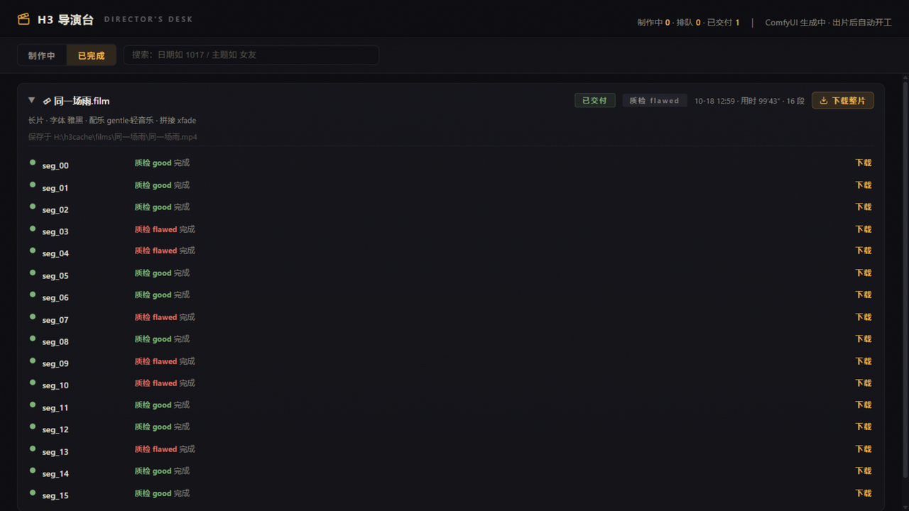
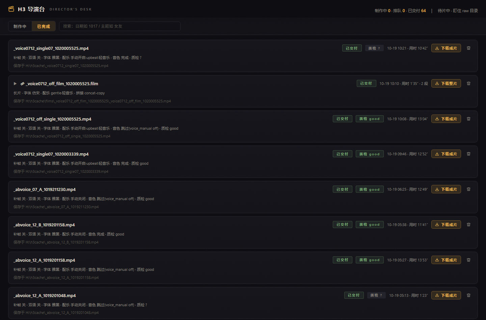
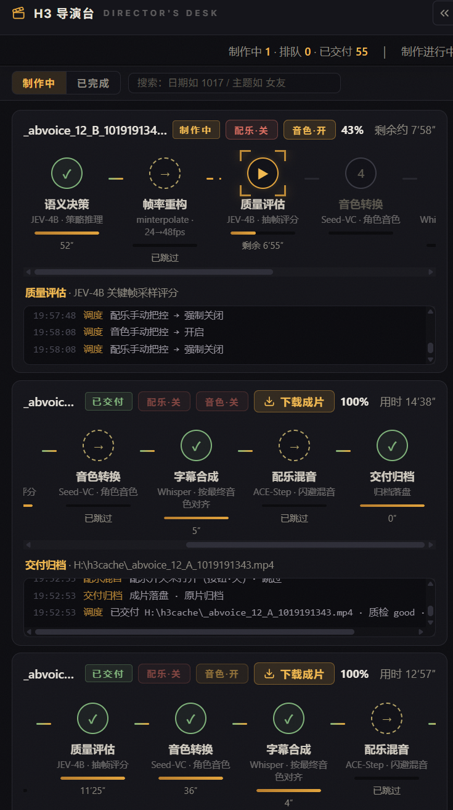

<div align="center">

# ComfyUI H3 Director

**把「H3 导演台」视频流水线接入 ComfyUI：一个侧栏面板、三个节点，加一份可部署的服务副本**


*从「能生成」到「能生产」：ComfyUI 负责出片，导演台负责发现任务、编排阶段、监控与交付，本仓库提供两者之间的全部集成胶水。*

**六阶段单条流水线** · **五阶段长片流水线** · **8GB 显存实测（0.3MP / 15s）** · **MIT 开源**

</div>

---

## 目录

| | | |
|---|---|---|
| [1. 定位：是什么 / 不是什么](#1-定位是什么--不是什么) | [2. 效果总览](#2-效果总览) | [3. 环境要求](#3-环境要求) |
| [4. 模型与组件清单](#4-模型与组件清单) | [5. 部署导演台服务](#5-部署导演台服务) | [6. 安装本插件](#6-安装本插件) |
| [7. 第一次闭环](#7-第一次闭环) | [8. 设计与实现](#8-设计与实现) | [9. 边界与许可](#9-边界与许可) |
| [10. FAQ 与目录结构](#10-faq-与目录结构) | [许可证](#许可证) | |

---

## 1. 定位：是什么 / 不是什么

本仓库包含两层：**集成层 ComfyUI 插件**（侧栏面板 + 三个节点），与**导演台服务的可部署副本**（`service/` 目录：`video_pipeline.py` 逐字节副本、长片工作流模板、JEV 决策粘合脚本、守卫/音色工具、适配指南）。按第 3–7 章从零执行，可在单机上跑通「投入视频文件或长片订单 → 自动六阶段处理 → 交付成片」的完整流水线。

需另行准备的内容仅三类，均有公开来源：**模型权重**（第 4 章清单）、**ComfyUI 本体**（官方安装文档）、**JEV 运行时与 Python 环境**（模型发布包自带运行时，见 [§5.2 第五步](#52-服务副本与路径适配)）。本仓库不下载、不运行其中任何一项。

| 它是什么 | 它不是什么 |
|---|---|
| ComfyUI 集成层插件：侧栏面板 + 状态 / 最近交付 / 提交长片三个节点 | 不是视频生成模型——**不含任何模型权重**（约 85GB，见第 4 章清单） |
| 导演台服务的可部署副本（与原件逐字节一致，md5 见 [§5](#5-部署导演台服务)） | 不是常驻服务进程——仓库不包含、也不会代为启动任何服务 |
| 导演台与 ComfyUI 的协作约定（raw 目录 + HTTP 接口） | 不接管 ComfyUI 队列、不 hook 采样器、不修改 ComfyUI 主程序 |
| 面向 Windows 单机的部署手册（本文） | 文档与实测数据——文中数据来自开发机环境，其他环境请自行验证 |

---

## 2. 效果总览

<table>
<tr>
<td width="50%"><sub>导演台控制台（127.0.0.1:8898）：制作中 / 排队 / 已交付统计与任务搜索</sub></td>
<td width="50%"><sub>单条视频六阶段详情：语义决策 → 帧率重构 → 字幕合成 → 质量评估 → 配乐混音 → 交付归档</sub></td>
</tr>
<tr>
<td width="50%"><sub>16 段长片逐段交付页：分段网格、逐段质检结论、整片下载</sub></td>
<td width="50%"><sub>已交付列表：成片条目、质检状态、下载与删除</sub></td>
</tr>
<tr>
<td width="50%"><sub>本插件把导演台嵌入 ComfyUI 侧栏「H3 制片台」</sub></td>
<td width="50%"><sub>ComfyUI 节点面板：H3/Director 分类下的三个节点</sub></td>
</tr>
</table>

---

## 3. 环境要求

实测边界来自开发机：**RTX 5070 Laptop（8GB 显存）+ 32GB 内存，Windows**。

| 项 | 要求 / 实测 |
|---|---|
| 操作系统 | Windows（路径处理基于 `pathlib`，理论跨平台，未在其他系统验证） |
| 显卡 | Nvidia 20 系及以上；**50 系必须使用 cu130 及以上版本的 PyTorch**（ComfyUI 官方要求） |
| 显存 | 8GB 可用，实测档位 **0.3MP 分辨率 / 15 秒时长**（H3 单段默认 5s、上限约 15s）；更高档位未验证 |
| 内存 | 32GB——H3 主模型 int8 单个约 19.5GB，JEV 4B 约 8.5GB，依赖内存换显存机制共存 |
| Python | 3.10+（开发机服务解释器为 ComfyUI venv 的 Python 3.13.3） |
| 磁盘 | H3 权重约 **85GB** + JEV 8.5GB + faster-whisper 0.5GB ≈ **94GB 必需**；可选 ACE-Step 套件另需 106.9GB；成片与缓存另留数十 GB |
| 网络 | 首次下载模型需外网（ModelScope / hf-mirror / HuggingFace） |

> [!TIP]
> 文本编码器仅有 NVFP4 AWQ 一种量化。模型作者的官方说明：*"This nvfp4 text encoder does not require Blackwell GPU to use"*（不要求 50 系；来源：[Comfy-Org/MiniMax-H3 README](https://huggingface.co/Comfy-Org/MiniMax-H3)）。

> [!WARNING]
> ComfyUI 本体不随本仓库安装。请直接使用官方文档：[Windows 桌面版](https://docs.comfy.org/installation/desktop/windows) / [Portable 版](https://docs.comfy.org/installation/comfyui_portable_windows) / [手动安装（含 PyTorch 版本选择）](https://docs.comfy.org/installation/manual_install)。安装后按 [§7.0 前提 5](#70-前提清单) 配置 `--output-directory`。

---

## 4. 模型与组件清单

> [!IMPORTANT]
> 本仓库**不包含**任何权重文件。H3 系列全部来自同一仓库 [Comfy-Org/MiniMax-H3](https://huggingface.co/Comfy-Org/MiniMax-H3)，[hf-mirror.com](https://hf-mirror.com/Comfy-Org/MiniMax-H3) 与 [ModelScope](https://modelscope.cn/models/Comfy-Org/MiniMax-H3) 提供同库镜像。

### 4.1 必需：H3 生成栈（约 85GB）

| 角色 | 文件名 | 量化 | 体积 |
|---|---|---|---|
| 主模型 · 文/图生视频 | `minimax_h3_fl2va_pruned_int8_convrot.safetensors` | int8_convrot | 19.5 GB |
| 主模型 · 参考图生视频 | `minimax_h3_ref2va_pruned_int8_convrot.safetensors` | int8_convrot | 19.5 GB |
| 主模型 · ref2va 备用链路 | `minimax_h3_ref2va_pruned_fp8_scaled.safetensors` | fp8_scaled | 19.5 GB |
| 文本编码器（Qwen3-VL-32B） | `qwen3vl_32b_minimax_h3_nvfp4_awq.safetensors` | NVFP4 AWQ | 14.6 GB |
| 视频 VAE · 量化 | `minimax_h3_video_vae_int8_convrot.safetensors` | int8_convrot | 2.6 GB |
| 视频 VAE · 高精度 | `minimax_h3_video_vae_fp16.safetensors` | fp16 | 4.8 GB |
| 音频 VAE | `minimax_h3_audio_vae_fp32.safetensors` | fp32 | 0.6 GB |
| turbo LoRA · FL2V 8 步 | `minimax_h3_fl2v_turbo_8step_v1.0_comfyui_bf16.safetensors` | bf16 | 1.8 GB |
| turbo LoRA · Ref2V 4 步 | `minimax_h3_ref2v_turbo_4step_v0.1_comfyui_bf16.safetensors` | bf16 | 1.8 GB |

> [!NOTE]
> 两个 turbo LoRA 的字节数相同（1,956,193,000），已对实际文件逐一核对。

### 4.2 必需：决策与字幕（约 9GB）

| 角色 | 名称 | 量化/格式 | 体积 | 下载 |
|---|---|---|---|---|
| JEV 决策/质检模型（4B） | `NeoHorse-Jev-4B` | bf16 | 8.5 GB | [HuggingFace TokenRhythm/NeoHorse-Jev-4B](https://huggingface.co/TokenRhythm/NeoHorse-Jev-4B) |
| 字幕对齐模型 | `Systran/faster-whisper-small` | CTranslate2 fp16 | 0.5 GB | [HuggingFace](https://huggingface.co/Systran/faster-whisper-small)（建议本地化，避免运行期联网） |

### 4.3 必需程序组件 与 可选组件

| 组件 | 必需性 | 获取方式 |
|---|---|---|
| ffmpeg 7.1 | 必需 | `pip install imageio-ffmpeg`（或系统 ffmpeg 进 PATH） |
| ACE-Step v1.5（BGM 生成） | 可选（不可用自动跳过配乐） | 开源仓库 [ACE-Step/ACE-Step](https://github.com/ACE-Step/ACE-Step)（Apache-2.0）；开发机使用 MusicAI 套件封装（106.9GB），与官方封装存在差异，需自行对齐 |
| Seed-VC（音色转换，`service/tools/h3_voice.py` 的外部依赖） | 可选 | 需自备 venv/CLI，见 [`service/ADAPT.md`](service/ADAPT.md) |

### 4.4 量化选择依据

**优先 `int8_convrot`，其次 `fp8_scaled`，不使用 GGUF。** H3 隐藏维度为 2688，不能被 256 整除，GGUF 标称 Q4 的版本实际发生退化。模型作者官方口径（[仓库 README](https://huggingface.co/Comfy-Org/MiniMax-H3)）：

> *"For diffusion models prefer `int8_convrot` if you are able to use pytorch with cu130."*
> *"`fp8_scaled` should only be used if you cannot use `int8_convrot`."*

**注意不对称**：ref2va 提供 fp8 备用链路；**fl2va 仅有 int8_convrot 一种量化，无备用**。

### 4.5 权重放置位置

文件必须落入 ComfyUI 标准模型子目录，否则工作流无法解析：

| 放置目录 | 放入的文件 |
|---|---|
| `<模型根>/diffusion_models/` | 三个主模型（fl2va / ref2va ×2） |
| `<模型根>/text_encoders/` | 文本编码器 |
| `<模型根>/vae/` | 视频 VAE ×2 + 音频 VAE |
| `<模型根>/loras/` | 两个 turbo LoRA |

`<模型根>` 可以是 `ComfyUI/models/`，也可以通过 `extra_model_paths.yaml` 映射独立目录（开发机实测配置）：

```yaml
comfyui:
  base_path: H:/MiniMax-H3      # 替换为你的模型根
  is_default: true
  diffusion_models: diffusion_models
  text_encoders: text_encoders
  vae: vae
  loras: loras
```

**下载渠道建议**：国内网络 ModelScope 最快；HuggingFace 直连不稳定时使用 `https://hf-mirror.com` 同库镜像（导演台服务的 `HF_ENDPOINT` 默认值也已是 hf-mirror.com，见 `service/video_pipeline.py:32`）。

---

## 5. 部署导演台服务

服务本体为 `service/video_pipeline.py`（与开发机原件逐字节一致，md5 `6accc9becf52c6b74a73e607113a7194`）。本节内联关键步骤；**全部 34 条路径的逐条对照表以 [`service/ADAPT.md`](service/ADAPT.md) 为准**。

### 5.1 依赖安装

服务本体仅用标准库；音色 / 字幕 / 守卫功能需要以下三方包，安装进**运行服务的 Python 环境**（开发机实测版本：numpy 2.5.2 / Pillow 12.3.0 / faster-whisper 1.2.1）：

```bash
pip install numpy pillow faster-whisper imageio-ffmpeg
```

### 5.2 服务副本与路径适配

> 下文 `<本仓库路径>` 指本仓库的存放位置（开发机为 `H:\h3cache\comfyui-h3-director`），示例以 `C:\H3DirectorDesk` 为目标程序目录，均可自定义。

**第一步：复制服务副本到程序目录**

```powershell
mkdir C:\H3DirectorDesk
copy "<本仓库路径>\service\video_pipeline.py" "C:\H3DirectorDesk\video_pipeline.py"
```

**第二步：修改路径常量。** 全部硬编码路径集中于 `video_pipeline.py` 开头常量区（34–77 行；字体表 127–134 行、whisper 模型 2108 行、审核目录 3186 行起）。最少需核对以下几组：

<details>
<summary><b>关键路径常量对照（展开；完整 34 条见 ADAPT.md）</b></summary>

| 常量（副本行号） | 原值 | 含义 / 修改方式 |
|---|---|---|
| `RAW`（:34） | `H:\h3cache\raw` | 待处理视频输入队列目录；**必须与 ComfyUI SaveVideo 输出目录一致** |
| `OUT`（:35） | `H:\h3cache` | 交付归档根（原始/失败/work/films 挂载其下） |
| `DL`（:39） | `D:\H3DirectorDesk` | 程序/配置目录（dialogue.json、模板、tools）→ 改为你的程序目录 |
| `CACHE` / `DOWNLOADS`（:40-41） | `H:\h3cache\h3_cache` / `downloads` | 运行状态/日志/历史 与 浏览器下载落点 |
| `FFMPEG`（:48） | `D:\ComfyUI\venv\...\ffmpeg-win-x86_64-v7.1.exe` | 三选一：① 指向 `imageio-ffmpeg` 包内 `binaries\` 的 exe（**文件名含版本号，以实际为准**）；② 系统 ffmpeg 进 PATH 后填 `"ffmpeg"`；③ 守卫工具经 `H3_GUARD_FFMPEG` 环境变量 |
| `COMFY`（:56） | `http://127.0.0.1:8188` | ComfyUI 地址 |
| `JUDGE_SCRIPT` / `JEV_PY` / `DECIDE_SCRIPT`（:49-51） | `H:\JEV\...` | JEV 决策脚本与独立 venv，按你的 JEV 部署修改 |
| `COMFY_INPUT`（:71） | `D:\ComfyUI\input` | ComfyUI LoadImage 输入图目录 |

</details>

**第三步：程序目录伴随文件**（与 `video_pipeline.py` 同目录存放，缺失时对应功能降级或报错）：

| 文件 | 必需性 | 来源 |
|---|---|---|
| `dialogue.json` | **必须** | 由 `service/config.example.json` 复制改名（全局台词/风格模板，全部键说明在文件内） |
| `h3_film_seg_template.json` | 长片闭环必须 | 本仓库已提供（与原件 md5 一致）；模板内仅裸模型文件名、无机器路径，无需修改 |
| `tools\` 子目录 | 可选 | 本仓库已提供：`h3_guard.py`（提示词守卫）、`h3_voice.py`（音色转换，需外部 Seed-VC）、`h3_prompt_skill.py` 及两份示例档案；不使用守卫/音色功能可整目录不带 |

> [!WARNING]
> 仓库内存在**两份同名的 `config.example.json`**，用途不同：`service/config.example.json` 复制到**程序目录**改名 `dialogue.json`（导演台配置）；仓库根目录的复制到**插件目录**改名 `config.json`（插件配置，见 §6）。

**第四步：字体与 whisper 模型。** 字体表（127–134 行）默认指向 `C:\Windows\Fonts` 的六款中文字体，缺失时回退雅黑（:2009-2010）；H3 风格字幕另硬编码 `Noto Sans SC.ttf`（:2037），缺失时 libass 回退默认字体、样式不保证。faster-whisper 推荐离线加载：

```bash
pip install -U huggingface_hub
set HF_HOME=<你的缓存根>
set HF_ENDPOINT=https://hf-mirror.com
huggingface-cli download Systran/faster-whisper-small
# 产出 <HF_HOME>\hub\models--Systran--faster-whisper-small\snapshots\<commit>\{model.bin,config.json,tokenizer.json,vocabulary.txt}
```

> 该目录布局已在开发机实测核对（snapshots 含上述 4 个文件）。备选：将 `wm` 常量改为 `"small"` 由 faster-whisper 自动下载（同样受 `HF_ENDPOINT` 影响）。

**第五步：JEV 决策环境**（六阶段第一阶与长片分镜的硬依赖）。三个粘合脚本本仓库已提供（`service/jev/`，与原件 md5 一致）；运行时随模型发布——[NeoHorse-Jev-4B](https://huggingface.co/TokenRhythm/NeoHorse-Jev-4B) 的 HF 发布包自带 `neohorse_decision` 运行时（`dist/*.whl` 或 `./package` 源码，见模型页 *Deployment and API Guide*）：

```bash
# 1) 下载完整发布包（backbone/ + tokenizer/ + pointer_head.safetensors + model_manifest.json + 运行时），解压到如 H:\JEV\NeoHorse-Jev-4B
# 2) 独立 venv 安装运行时与依赖
#    模型页记录环境：Python 3.12 / torch 2.8 / transformers 5.17 / triton 3.7.1 / flash-linear-attention 0.5.2
#    开发机 venv 实测：torch 2.11.0+cu128 / transformers 5.19.0 / accelerate 1.15.0 / bitsandbytes 0.50.2
python -m venv H:\JEV\venv
H:\JEV\venv\Scripts\pip install <模型包内 dist/neohorse_decision-1.0.0-py3-none-any.whl> --no-deps
H:\JEV\venv\Scripts\pip install torch transformers accelerate bitsandbytes
# 3) 复制脚本并修改常量
copy "<本仓库路径>\service\jev\*.py" "H:\JEV\"
#    三个脚本内 MODEL_DIR（video_decide.py:12 / storyboard_decide.py:15 / h3_judge.py:25）按你的路径修改；
#    再将 video_pipeline.py 的 JUDGE_SCRIPT / JEV_PY / DECIDE_SCRIPT / STORYBOARD_SCRIPT（:49-51、:63）指向它们
```

> [!NOTE]
> JEV 默认 `device=cpu`：8GB 显存无法容纳 9GB 权重，决策与质检在生成间隙执行，且检测到 ComfyUI 正在生成时拒绝加载（内存保护），因此不与 H3 争抢显存。

**第六步：确认其余外部服务。** ComfyUI（:8188，需已装入 H3 工作流，见 §7.0 前提 4/5）；音乐引擎 ACE-Step（`http://127.0.0.1:8001/health`，服务按需自动拉起，不可用自动跳过配乐）。

> [!TIP]
> 落地目录无需手动创建：服务启动时自动建立 `RAW` / `原始` / `work` / `失败` / `films` / `downloads` / `h3_cache`（`video_pipeline.py:3215-3216`）。只需保证各常量指向的磁盘根目录存在且可写。

### 5.3 启动

```powershell
# 方式一：直接启动（解释器换成装有 §5.1 依赖的那个）
& "D:\ComfyUI\venv\Scripts\pythonw.exe" "C:\H3DirectorDesk\video_pipeline.py"

# 方式二：重启脚本副本（先改两处：第 8 行解释器、第 9 行脚本路径）
powershell -NoProfile -ExecutionPolicy Bypass -File "<本仓库路径>\service\restart_pipeline.example.ps1"
```

端口 8898 被占用时新实例自动退出（单实例保护，`video_pipeline.py:3211-3213`）。开机自启可将方式二加入任务计划程序。

### 5.4 健康检查与启动排查

```bash
curl http://127.0.0.1:8898/status    # 返回 200 与 JSON 即在线；控制台页面 http://127.0.0.1:8898/
```

`pythonw` 无窗口、配置错误时会静默退出，排查方法：

```powershell
# 前台运行一次，报错直接输出到终端
& "D:\ComfyUI\venv\Scripts\python.exe" "C:\H3DirectorDesk\video_pipeline.py"
```

- 常见首发错误：`dialogue.json` 不在程序目录（处理首个任务时触发）；路径常量指向不存在的盘符
- 后台运行日志：`<CACHE>\pipeline.log`（常量 `LOGF`，`video_pipeline.py:44`）
- 端口占用提示「导演台已在运行（端口被占），本实例退出」属单实例保护，非故障

---

## 6. 安装本插件

要求：ComfyUI 0.3+（新旧前端均可）、Python 3.10+、导演台服务已通过 §5.4 健康检查。插件仅依赖标准库。

### 6.1 三种安装方式

```bash
# A. ComfyUI-Manager（推荐）：Manager → Install via Git URL → 填 <本仓库地址> → 重启 ComfyUI

# B. 手动克隆
cd <你的ComfyUI>/custom_nodes
git clone <本仓库地址> comfyui-h3-director
# 重启 ComfyUI

# C. 开发模式（软链接，管理员 cmd）
mklink /D "<你的ComfyUI>\custom_nodes\comfyui-h3-director" "<本仓库路径>"
```

重启后：节点面板 **H3/Director** 分类出现三个节点，左侧栏出现「H3 制片台」。

### 6.2 配置（config.json）

复制根目录 `config.example.json` 为插件目录内 `config.json`（已被 `.gitignore` 忽略）：

```json
{
  "director_url": "http://127.0.0.1:8898",
  "raw_dir": "H:/h3cache/raw",
  "timeout": 8
}
```

| 字段 | 说明 | 环境变量覆盖 |
|---|---|---|
| `director_url` | 导演台地址，末尾不带 `/` | `H3_DIRECTOR_URL` |
| `raw_dir` | **必须等于导演台的 `RAW` 常量目录**，「提交长片」节点写入目标 | `H3_DIRECTOR_RAW_DIR` |
| `timeout` | HTTP 超时秒数（1–60） | `H3_DIRECTOR_TIMEOUT` |

优先级：节点输入 > 环境变量 > `config.json` > 默认值（`config.py:44-46`）。

### 6.3 节点速览

| 节点 | 输出 | 说明 |
|---|---|---|
| `H3DirectorStatus` 状态 | `summary` / `status_json` | 只读 `/status`，输出一行摘要与原始 JSON |
| `H3DirectorLastResult` 最近交付 | `file / verdict / font / bgm / mood / download_url / raw_json` | 只读最近一次交付，适合接通知或归档 |
| `H3DirectorSubmitFilm` 提交长片 | `film_json` / `message` | 原子写 `<片名>.film.json` 到 `raw_dir`；不等待生成完成 |

### 6.4 对现有 ComfyUI 环境的影响

| 风险点 | 约束 |
|---|---|
| 修改 ComfyUI 主程序 | 仅使用 `NODE_CLASS_MAPPINGS`、`WEB_DIRECTORY`、`PromptServer.routes` 三个公开扩展点 |
| 干扰队列 / 采样 | 不 hook `PromptServer.prompt_queue`，不调用 `/prompt`、`/interrupt` |
| 与既有侧栏冲突 | tab id 为 `h3DirectorPanel`，注册前检测同 id 已存在则跳过；与旧定制抽屉（`h3DirectorDesk`）可共存 |
| 影响启动稳定性 | 路由注册与配置读取全部 `try/except`；配置损坏时回退默认值 |
| 越权写盘 | 仅向用户配置的 `raw_dir` 原子写入任务文件（临时文件 + `os.replace`） |
| 阻塞工作流 | 所有 HTTP 调用带超时；连接失败直接返回明确错误，不重试 |
| 卸载残留 | 删除插件目录即可；不写注册表、不写用户目录 |

---

## 7. 第一次闭环

### 7.0 前提清单

| # | 前提 | 达成方式 |
|---|---|---|
| 1 | 导演台服务在线 | §5.4 健康检查返回 200 |
| 2 | 插件已装、`raw_dir` 配置一致 | §6；`raw_dir` = 导演台 `RAW` 常量目录 |
| 3 | ComfyUI 在线 + H3 权重就位 | 官方文档安装（50 系 cu130+）；权重按 §4.5 落位 |
| 4 | ComfyUI 已装入 H3 工作流 | 官方模板：[t2v](https://github.com/Comfy-Org/workflow_templates/blob/main/templates/video_minimax_h3_t2v.json) / [i2v](https://github.com/Comfy-Org/workflow_templates/blob/main/templates/video_minimax_h3_i2v.json) / [r2v](https://github.com/Comfy-Org/workflow_templates/blob/main/templates/video_minimax_h3_r2v.json)；教程 [docs.comfy.org/tutorials/video/minimax/minimax-h3](https://docs.comfy.org/tutorials/video/minimax/minimax-h3) |
| 5 | ComfyUI 输出目录 = raw 目录 | 启动参数 `--output-directory <RAW目录>`（开发机实证：`main.py --lowvram --cache-none --disable-pinned-memory --output-directory H:/h3cache/raw`） |
| 6 | 长片模板已复制到程序目录 | §5.2 第三步；模板 SaveVideo 前缀 `filmseg_` 已内置 |
| 7 | JEV 已部署且路径常量已改 | **硬前提**，无降级路径；部署见 §5.2 第五步 |

### 7.1 路线 A：单条视频闭环（最短路径）

在 ComfyUI 中运行官方 H3 工作流（t2v / i2v），SaveVideo 输出自然落入 raw 目录；导演台发现该 mp4 后自动执行六阶段后处理。无需提交任何订单文件。

### 7.2 路线 B：长片闭环（一个订单产出整片）

**投订单**（片名不能含路径分隔符）：

```powershell
copy "<本仓库路径>\examples\film.example.json" "<你的RAW目录>\我的第一部长片.film.json"
```

> [!WARNING]
> 投放目录**必须**是导演台 `RAW` 常量指向的目录。投错位置不会有任何报错——detector 只扫描自己的 raw 目录，订单将无限期滞留。

编辑订单内容（`lines` 一行一句；段数 = ⌈行数/3⌉）：

```json
{
  "style": "3D 卡通都市恋爱，克制、温柔、真实沟通",
  "lang": "zh",
  "lines": ["第一句台词", "第二句台词", "第三句台词", "第四句台词"],
  "reuse": []
}
```

也可以在 ComfyUI 工作流中使用「提交长片」节点填入同样内容，由节点原子写入。

**观察进度**：打开 `http://127.0.0.1:8898/` 或 ComfyUI 侧栏「H3 制片台」。detector 每 4 秒扫描一次，订单在数秒内出现为任务卡片；示例 4 句台词切为 2 段，逐段可见 分镜 → 生成 → 质检 → 字幕 的推进。

**收片**：

- 长片：`<OUT>\films\<片名>\<片名>.mp4`（同目录含 `seg_XX.mp4` 分段与 `manifest.json`）
- 单条：`<OUT>\<视频名>.mp4`
- 页面「下载整片 / 下载成片」走 `GET /download?name=<...>`；中文文件名由浏览器自动 URL 编码；每次下载同步镜像至 `<DOWNLOADS>` 目录

---

## 8. 设计与实现

本章将导演台（约 3200 行）的设计按主题归类，行号引用均指 `service/video_pipeline.py`。

### 8.1 总体架构：生成与编排分离

ComfyUI 只负责出片，导演台只负责发现任务、编排阶段、监控与交付，两者通过 raw 目录与 HTTP 接口协作，可各自独立升级与重启。导演台对 ComfyUI 是**纯 HTTP 客户端**：`GET /queue` 探测忙闲防止显存叠加；长片模式改写模板节点后 `POST /prompt` 并轮询 `/history` 取片（SaveVideo 落 raw，`filmseg_` 前缀防重入）；首帧与种子帧复制进 ComfyUI input 目录供 LoadImage 使用。

```text
投 mp4  /  <片名>.film.json
            │
            ▼
┌──────────────────────────────────────────────────────────────────────────┐
│ raw 目录（任务入口，= ComfyUI SaveVideo 输出目录）                       │
│ detector：每 4s 扫描；mp4 需大小连续两轮稳定且 >1MB 才入队（:721）       │
│ FIFO 队列 ──► worker（单线程串行执行，一次一条）                         │
│ 交付根：原始\ work\ 失败\ films\ downloads\ h3_cache\（状态/历史）       │
└───────────┬──────────────────────────────────────────────────────────────┘
            │
            ▼
┌──────────────────────────────────────────────────────────────────────────┐
│ H3 导演台 video_pipeline.py · 127.0.0.1:8898（:3210）                    │
│ HTTP：GET /status · /download · /（控制台）                              │
│       POST /task/bgm · /task/voice · /task/delete                        │
│ 后台线程：detector · worker · 审核入库 watcher（:3186）                  │
│ 程序目录：dialogue.json、h3_film_seg_template.json、tools\               │
└───────────┬──────────────────────────────────────────────────────────────┘
            │
            ├─ HTTP ───────► ComfyUI :8188（/queue · /prompt · /history）
            ├─ 首帧/种子帧 ─► ComfyUI\input（供 LoadImage）
            └─ 子进程 ──────► JEV venv（决策/分镜/质检）
                               ACE-Step :8001（按需拉起，BGM）
                               faster-whisper（字幕对齐）

        ▲ 只读嵌入 /status（iframe） · 写 <片名>.film.json 到 raw
┌──────────────────────────────────────────────────────────────────────────┐
│ 本插件 comfyui-h3-director（侧栏面板 + 三个节点）                        │
│ 对导演台：GET /status（只读） · 对 raw 目录：写 <片名>.film.json 订单    │
└──────────────────────────────────────────────────────────────────────────┘
```

### 8.2 双状态机：单条六阶段与长片五阶段

阶段可跳过、可失败、重启后从 history / 订单恢复——这是断点续跑的前提。

- **单条六阶段**：语义决策 → 帧率重构（可选）→ 字幕合成 → 质量评估 → 配乐混音 → 交付归档；每阶段写入 `start/detail/end` 事件进入全局事件流
- **长片五阶段**：分镜 → 逐段（复用/生成 → 归一化 → 质检 → 字幕）→ 拼接 → 整片配乐 → 交付；质检未通过换 seed 原位重跑，上限 2 次
- **film.json 契约**：`style / lang / lines / reuse`；段数只由台词行数决定（每段 ≤3 行，段数 = ⌈行数/3⌉），`reuse` 数量不影响段数——同一剧本的切分边界因此保持稳定

### 8.3 单线程串行执行

H3、JEV、ACE-Step 均大量占用内存与显存，8GB 显存下并发必然导致显存溢出。导演台采用 FIFO 队列 + 单 worker 串行执行；控制台可同时展示多条线路，但实际执行始终保持一条。这是 §3 实测边界成立的前提，也是吞吐上限来自设计而非缺陷。

### 8.4 JEV 的职责边界：只决策、不生成

本地 4B 模型只承担语义决策、长片分镜、抽帧质检与废片筛除，**不参与生成过程，也无法提升单条画质**。长片流程中 JEV 仅回答：是否分镜、每条边界 cut/crossfade、风格锚、字体、整片 BGM 需求与情绪；边界数量多时拆分为「全局问题 + 转场分批」以规避单次问题上限。

### 8.5 任务发现机制与两个部署硬前提

detector 每 4 秒扫描 raw 目录（:721、:3205）。**「大小连续两轮稳定且 >1MB」的入队规则仅作用于 `.mp4`**（:3142-3152，防止半写文件进入流水线）；`.film.json` 订单走独立分支（:3160-3162），落盘且 JSON 解析通过即入列、无大小门槛。由此产生两个部署硬前提：

1. ComfyUI 的 **SaveVideo 输出目录必须等于 `RAW` 常量目录**，否则任务不可见（实现方式：`--output-directory` 启动参数）
2. 长片分段前缀必须为 **`filmseg_`**（:66），detector 据此跳过段产物、避免分段被当作新任务重复处理（模板内置该前缀，导演台运行时还会改写为 `filmseg_<片名>_s<段号>`，:705）

### 8.6 长片顺序锁与无损拼接

- **顺序锁**：分段重跑仅在原 idx 原位替换（`os.replace`）；拼接只按 idx 顺序读取分段、写入新文件——任何一次重拼都不会改动分段源文件
- **拼接策略**：全 cut 且参数一致走 `concat -c copy` 无损拼接；含 crossfade 走 xfade 链；参数不一致先生成归一化副本再拼接

### 8.7 字幕为什么必须后处理

扩散模型直接渲染文字必然产生乱码，因此提示词层面保持画面无文字，字幕统一走后处理：长片先检测 H3 自带字幕，存在则跳过烧录；否则由 faster-whisper 对齐时间轴后以 ASS 格式烧录。

### 8.8 H3 生成侧的三个工程细节

- **音画联合生成**：语音、音效、音乐与画面在同一次前向中联合建模并输出原生立体声，口型与语音同源——这是选择 H3 而非「视频模型 + 后期 TTS」的根本原因（后者口型无法对齐）
- **turbo LoRA**：FL2V 8 步与 Ref2V 4 步两个 bf16 LoRA 分别将采样步数从 20 压缩至 8 / 4
- **帧数对齐**：时长按 17k+5 网格对齐（`max(5, round(a*24)) + (5 - (max(5, round(a*24)) % 17)) % 17`），24fps，单段默认 5 秒、上限约 15 秒

### 8.9 量化选择

见 [§4.4](#44-量化选择依据)。要点：隐藏维度 2688 不被 256 整除导致 GGUF 退化；`int8_convrot` 为主力（需 cu130），`fp8_scaled` 为 ref2va 备用链路。

### 8.10 可观察、可恢复、可追溯

`/status` 快照、带序号事件流、粘性日志、自适应 ETA、`pipeline_history.json` 与长片 `manifest.json` 共同支撑无人值守运行。监控为增量渲染而非流式输出：前端每 1.5 秒拉取 `/status`，事件按 `seq` 增量追加（每线路上限 80 行），阶段进度以 400ms 时钟插值平滑显示；日志上滚后固定位置并提示「N 条新输出 · 回到最新」。

### 8.11 显卡与 PyTorch 版本要求

ComfyUI 官方要求 Nvidia 20 系及以上使用 **cu130 及以上**版本 PyTorch（开发机 `D:/ComfyUI/README.md:197` 出处标注）——即 §3 中 50 系要求的依据。

---

## 9. 边界与许可

- **本仓库不含模型权重，也不含任何服务进程。** 权重按第 4 章自行获取，服务按第 5 章自行部署。
- **不在读者机器上执行过生成。** 文中全部实测数据（0.3MP/15s 档位、依赖版本、md5）来自开发机；读者环境的结果需自行验证。
- **组件必需性分级**：ComfyUI + H3 权重 + ffmpeg **必需**；faster-whisper **条件必需**（检测到 H3 自带字幕时跳过）；ACE-Step **可选**（不可用自动跳过配乐）；**JEV 必需且无降级路径**——缺失或路径错误时，单条任务在六阶段第一阶抛出 `RuntimeError("JEV 决策未产出…")`（:2348）、长片在分镜阶段失败（:2629），任务进入失败目录。
- **字体回退链**：首选字体缺失时回退雅黑粗体（:2009-2010）；雅黑亦缺失（如非中文 Windows 且未安装中文字体）时字幕阶段异常，需自备中文字体并修改 `FONTS` 表（127–134 行）。
- **8GB 显存的档位与代价**：仅支持 0.3MP / 15s；为防止显存叠加强制单线程串行（§8.3），低吞吐是设计选择。更高档位未经验证。
- **许可**：本仓库代码 **MIT**（[LICENSE](LICENSE)）。第 4 章各模型有其独立许可；如工作流引用 Ideogram 等第三方模型，注意其**非商业条款**，商用前自行核对。

---

## 10. FAQ 与目录结构

<details>
<summary><b>FAQ（14 问，展开）</b></summary>

**Q1：投了 mp4 / film.json，导演台没反应？**
mp4 需等待大小连续两轮稳定且 >1MB（约 4–8 秒，半写保护）；film.json 落盘且 JSON 解析通过即入列——`lines` 非数组等解析失败会静默跳过等下一轮（`video_pipeline.py:3168-3174`），请先自行校验 JSON。两者都必须落在导演台监听的 raw 目录。

**Q2：长片分段被当成新任务重复处理？**
检查 SaveVideo 文件名前缀必须为 `filmseg_`，且输出目录必须是 raw 目录（§8.5）。

**Q3：侧栏没有「H3 制片台」？**
查看浏览器控制台 `[H3Director]` 日志；确认无同 id 标签；硬刷新（Ctrl+F5）。与旧定制抽屉（`h3DirectorDesk`）id 不同，可共存。

**Q4：状态节点报「连不上导演台」？**
插件不负责启动服务。先确认 `http://127.0.0.1:8898/status` 可访问；远程部署修改 `director_url`。

**Q5：8GB 显存 OOM / 需要更快？**
保持在 0.3MP / 15s 档；确认 PyTorch cu130+（50 系）；避免并发投递任务——导演台本身串行执行（§8.3），同时运行 ComfyUI 其他重任务会造成显存叠加（投片前有 `GET /queue` 探忙保护）。

**Q6：模型下载慢 / 失败？**
国内优先 ModelScope；HF 直连不稳走 hf-mirror（§4.5）。

**Q7：如何在 ComfyUI 工作流里直接提交长片？**
使用「提交长片」节点；`film_name` 不能含路径分隔符；节点只写入订单、不等待生成。

**Q8：如何停止 / 重启导演台？**

```powershell
Get-CimInstance Win32_Process -Filter "Name='pythonw.exe' or Name='python.exe'" |
  Where-Object { $_.CommandLine -like '*video_pipeline.py*' } |
  ForEach-Object { Stop-Process -Id $_.ProcessId -Force }
```

重启用 §5.3 任一方式；重启后任务从 history / 订单恢复。

**Q9：两份 `config.example.json` 的区别？**
`service/config.example.json` → 复制到**程序目录**改名 `dialogue.json`（导演台配置）；根目录 `config.example.json` → 复制到**插件目录**改名 `config.json`（插件配置）。

**Q10：长片模板从哪来？要改吗？**
本仓库自带（`service/h3_film_seg_template.json`，与原件 md5 一致），复制到程序目录即可；内为裸模型文件名，无需修改。导演台每段自动改写其中 5 个节点。

**Q11：JEV 从哪下载？**
粘合脚本在 `service/jev/`（仓库自带）；模型与运行时均在 [NeoHorse-Jev-4B](https://huggingface.co/TokenRhythm/NeoHorse-Jev-4B) 发布包；依赖清单见 §5.2 第五步。装好后修改脚本 `MODEL_DIR` 与 `video_pipeline.py:49-51、:63` 四个常量。

**Q12：模型放哪了 ComfyUI 找不到？**
见 §4.5：文件必须落入四个标准子目录（或经 `extra_model_paths.yaml` 映射），文件名与工作流引用一致。

**Q13：这套东西的吞吐上限？**
8GB 显存下 H3 单段 15s 约 30 分钟量级（0.3MP、turbo 档），导演台串行编排不改变该上限；吞吐由生成端决定，编排端的职责是无人值守与失败恢复。

</details>

### 目录结构

```text
comfyui-h3-director/
├── README.md                       本文档
├── LICENSE / PUBLISHING.md / pyproject.toml / version.py
├── __init__.py                     节点注册 + 只读配置路由
├── nodes.py                        三个节点
├── director_client.py              /status 客户端与摘要
├── config.py / config.example.json 配置与 film.json 原子写 / 插件配置模板
├── web/js/h3_director.js           侧栏面板
├── examples/film.example.json      长片订单示例
├── tests/                          纯逻辑单测（python -m unittest discover -s tests -v）
├── docs/screenshots/               本文全部截图（6 张 png）
└── service/                        导演台服务可部署副本
    ├── video_pipeline.py            服务本体（与原件逐字节一致）
    ├── h3_film_seg_template.json    长片工作流模板（md5 与原件一致）
    ├── restart_pipeline.example.ps1 重启脚本副本（改两处路径后可用）
    ├── config.example.json          dialogue.json 模板
    ├── jev/                         JEV 三个粘合脚本（md5 与原件一致；运行时与权重从 HF 获取）
    ├── tools/                       守卫/音色/提示词技能脚本 + 示例档案（h3_voice 需外部 Seed-VC）
    └── ADAPT.md                     新机部署适配指南（34 条路径对照表）
```

---

<div align="center">

*本仓库仅包含集成层插件与导演台服务的可部署副本，不包含 H3 模型权重，也不包含任何运行中的服务进程。*

</div>

---

## 许可证

本项目采用 **MIT License**，与仓库根目录的 [LICENSE](LICENSE) 文件内容一致：

```text
MIT License

Copyright (c) 2026 Devin

Permission is hereby granted, free of charge, to any person obtaining a copy
of this software and associated documentation files (the "Software"), to deal
in the Software without restriction, including without limitation the rights
to use, copy, modify, merge, publish, distribute, sublicense, and/or sell
copies of the Software, and to permit persons to whom the Software is
furnished to do so, subject to the following conditions:

The above copyright notice and this permission notice shall be included in all
copies or substantial portions of the Software.

THE SOFTWARE IS PROVIDED "AS IS", WITHOUT WARRANTY OF ANY KIND, EXPRESS OR
IMPLIED, INCLUDING BUT NOT LIMITED TO THE WARRANTIES OF MERCHANTABILITY,
FITNESS FOR A PARTICULAR PURPOSE AND NONINFRINGEMENT. IN NO EVENT SHALL THE
AUTHORS OR COPYRIGHT HOLDERS BE LIABLE FOR ANY CLAIM, DAMAGES OR OTHER
LIABILITY, WHETHER IN AN ACTION OF CONTRACT, TORT OR OTHERWISE, ARISING FROM,
OUT OF OR IN CONNECTION WITH THE SOFTWARE OR THE USE OR OTHER DEALINGS IN THE
SOFTWARE.
```

> 模型权重与第三方组件各有独立许可（见 [§4 模型清单](#4-模型与组件清单)、[§9 边界与许可](#9-边界与许可)）：MIT 仅覆盖本仓库代码本身；H3 权重遵循 [Comfy-Org/MiniMax-H3](https://huggingface.co/Comfy-Org/MiniMax-H3) 的发布条款，JEV 遵循 [NeoHorse-Jev-4B](https://huggingface.co/TokenRhythm/NeoHorse-Jev-4B)（Apache-2.0），商用前请自行核对各模型条款。

